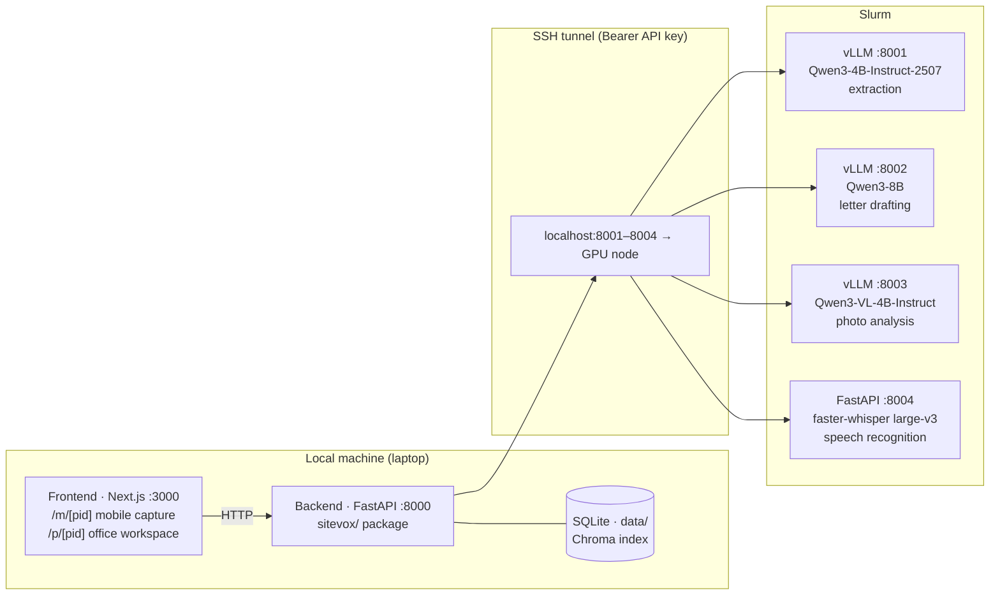

# SiteVox – AI assistant for the contractor's site manager

SiteVox turns what a site manager says, photographs and receives on a German building site into an
**evidence-backed** site diary (Bautagebuch), a planned-vs-actual analysis and draft notices under VOB/B.
The perspective is always the contractor (Auftragnehmer, AN) writing to the client (Auftraggeber, AG).
The user interface is German, with English as a second UI language.

> Draft – no legal advice. Every output must be checked by the site management before it is used.

Further documentation:

| Document | Content |
|---|---|
| [docs/PIPELINE.md](docs/PIPELINE.md) | Every processing step in GPU mode: method, model, output, prompt examples |
| [docs/MOCK_DATA.md](docs/MOCK_DATA.md) | How the synthetic scenarios, voice notes and photos were built |
| [docs/EVALUATION.md](docs/EVALUATION.md) | What was tested, how often, results and the comparison between versions |
| [evaluation/README.md](evaluation/README.md) | Evaluation scripts and protocol (German) |
| [docs/README.zh.md](docs/README.zh.md) | Previous README (Chinese), with UI details, mailbox setup and merge notes |

---

## 1. Design principles

| Principle | Where it is enforced |
|---|---|
| **LLMs only understand and write.** Deviations, critical path, deadlines, risk sphere and confidence are computed by deterministic Python code. | `sitevox/understand/` (models) vs. `sitevox/engine/`, `sitevox/confidence.py` (rules) |
| **Every fact has evidence.** Every drafted sentence cites evidence IDs `[E-xx]`; every number, date, time and name is checked against the cited evidence. Unsupported values block the release. | `sitevox/verify.py` |
| **The AI never sends anything.** Releasing a letter only opens the send dialog; sending requires an explicit confirmation by the site manager. | `sitevox/drafting/composer.py`, `sitevox/export/smtp_send.py` |

---

## 2. Architecture



The frontend and all business logic run locally. Only the four model services run on the GPU node. The backend
does not know that the models are remote: it talks to `localhost:8001–8004`, which the SSH tunnel forwards to the
compute node.

### Repository layout

```text
backend/                FastAPI app (main.py routes, views.py view models)
frontend/               Next.js 15 + React 19 + Tailwind PWA
sitevox/                core package
  understand/           asr.py · vision.py · extract.py · documents.py · ocr.py · email_ingest.py · imap_mail.py
                        gaeb_io.py · contract_info.py · contacts.py · report_info.py · pdf_layout.py
  engine/               schedule.py (CPM) · deviation.py (planned vs. actual, alerts, impact chain)
                        sphere.py (risk sphere rules) · deadlines.py · weather.py (DWD via Bright Sky) · timeline.py
  drafting/             composer.py + templates/*.j2 (de/en letter templates)
  export/               daily_report.py · report_pdf.py · report_docx.py · privacy.py · smtp_send.py · outlook.py
  confidence.py verify.py rag.py pipeline.py store.py llm.py prompts.py schemas.py settings.py
config/                 models.toml · rules.toml · baseline.yaml
scripts/                serve_models.py · seed_demo.py · make_demo_data.py · run_scenario.py
  cluster/              Slurm jobs, ASR server, SSH tunnel
  data/                 audio and scenario data generation, dataset packaging
evaluation/             eval_asr.py · eval_capture_scenario.py · eval_extract.py · eval_verify.py · metrics.py
data/demo/              demo project BV-RIEM, gold scenarios, replay fixtures
data/knowledge/         VOB/B and BGB excerpts (legal RAG collection)
tests/                  pytest suite
```

---

## 3. Tech stack

| Layer | Technology |
|---|---|---|
| Frontend | Next.js 15.5, React 19, TypeScript 5.7, Tailwind CSS 3.4, lucide-react |
| Backend API | FastAPI, uvicorn, Pydantic 2, httpx, `openai` client (OpenAI-compatible endpoints) |
| Storage | SQLite (`data/sitevox.db`), files under `data/<project>/<date>/`, Chroma index |
| Retrieval | rank_bm25, Chroma, BAAI/bge-m3, BAAI/bge-reranker-v2-m3 |
| Documents | Docling, pdfplumber, pypdf, python-docx, openpyxl, RapidOCR + onnxruntime, gaeb |
| Rules engine | plain Python (`sitevox/engine/`), thresholds in `config/rules.toml` |
| Drafting / export | Jinja2 templates (de/en), ReportLab (PDF), python-docx (DOCX), OpenCV (face blurring), Pillow (EXIF) |
| Mail | IMAP (read-only import), SMTP (send after confirmation), `.eml` drafts for Outlook |
| Weather | Bright Sky API (open DWD data, no key) |
| LLM serving | vLLM 0.32, torch 2.13, transformers 5.19 |
| Models | Qwen3-4B-Instruct-2507 (extraction), Qwen3-8B (drafting), Qwen3-VL-4B-Instruct (vision) |
| Speech | faster-whisper large-v3 (CTranslate2, fp16) behind a small FastAPI service |
| Cluster | Slurm, SSH ProxyJump tunnel, Bearer API key | 

---

## 4. Demo mode (no GPU)

Demo mode replays stored model outputs (`data/demo/BV-RIEM/fixtures/`) and uses keyword heuristics for new
input. It is deterministic and is used for tests and offline presentations.

```bash
python3 -m venv .venv && .venv/bin/pip install -r requirements.txt
.venv/bin/python scripts/make_demo_data.py
.venv/bin/python scripts/seed_demo.py                # runs the demo day (20.11.2026) through the pipeline
SITEVOX_TODAY=2026-11-20 .venv/bin/uvicorn backend.main:app --port 8000

cd frontend && npm install && npm run build && npm start   # http://localhost:3000/p/BV-RIEM
```

Mobile capture needs HTTPS (camera and microphone):

```bash
bash scripts/make_cert.sh                              # Windows: python scripts/make_cert.py
cd frontend && npm run build && HTTP_REDIRECT_PORT=3000 npm run start:https
# phone: https://<laptop-ip>:3443/m/BV-RIEM  (same network; accept the certificate once)
```

Tests:

```bash
.venv/bin/python -m pytest -q tests --basetemp=.pytest_tmp -p no:cacheprovider
```

---

## 5. GPU mode – runbook

### 5.1 Start the model services (every session)

```bash
sbatch scripts/cluster/serve_models_single.sbatch
squeue -u $USER -n sitevox-llm                          # wait for state R, note the node
tail -f data/serve_slurm_$(squeue -u $USER -n sitevox-llm -h -o %i | head -1).log
# ready when the log shows "Alle Dienste bereit."
cat ~/.config/sitevox/api_key                           # copy for the local backend
```

The job starts the three vLLM servers one after another on the same GPU (waiting for `/health` each time), then
the ASR server. Logs per service: `data/serve_extractor.log`, `serve_drafter.log`, `serve_vision.log`,
`serve_asr.log`. Stop with `scancel -n sitevox-llm`.

### 5.2 Connect the local machine

```bash
# terminal 1 – keep open; re-run after every new job (the node may change)
USER=<hpc-user> bash scripts/cluster/tunnel.sh            # or: … tunnel.sh <node>
# check
curl localhost:8004/health
curl -H "Authorization: Bearer <key>" localhost:8001/v1/models

# terminal 2 – backend
export SITEVOX_MODE=gpu
export SITEVOX_ASR_BACKEND=remote
export SITEVOX_VISION_BACKEND=openai
export SITEVOX_LLM_API_KEY=<key>
uvicorn backend.main:app --port 8000

# terminal 3 – frontend
cd frontend && npm run dev                                     # http://localhost:3000
```

### 5.4 End-to-end benchmark on the cluster

```bash
sbatch --export=ALL scripts/cluster/scenario_e2e.sbatch        # 4 scenario days × de/en/pl/tr
# results: outputs/eval/scenario_<ID>_<date>_<lang>_<job>/summary.md and result.json
```

### 5.5 Troubleshooting

| Symptom | Cause and fix |
|---|---|
| `curl: (56) Connection reset by peer` | Tunnel is up but nothing listens on the node yet (still loading), or the tunnel points to an old node. Check `squeue`, re-run `tunnel.sh`. |
| `401 unauthorized` | Local `SITEVOX_LLM_API_KEY` differs from `~/.config/sitevox/api_key`. |
| `Ninja build failed … nvcc: No such file` | FlashInfer JIT needs nvcc. The job sets `VLLM_USE_FLASHINFER_SAMPLER=0`. |
| A vLLM service never becomes ready | Weight loading from `$WORK` (NFS) can be very slow at busy times. Resubmit later or copy weights to `$TMPDIR` first. |
| Variables set before `sbatch` are ignored | The jobs use `--export=NONE`. Pass overrides as `sbatch --export=NONE,EXTRACTOR=/path …`. |
| `sbatch: error: getcwd failed` | The shell is in a deleted directory. `cd` into the repository again. |

---

## 6. Configuration

### 6.1 `config/models.toml`

| Section | Key settings |
|---|---|
| `[runtime]` | `mode` (`demo` \| `gpu`), `device` (`cuda` \| `mps` \| `cpu`), `data_dir`, `db_path`, `timezone` |
| `[asr]` | `backend` (`faster_whisper` \| `whisperx` \| `mlx_whisper` \| `remote`), `remote_url`, `model = "large-v3"`, `language = "auto"`, `allowed_languages = ["de","en","tr","pl"]`, `beam_size`, `vad_filter`, `initial_prompt` and `[asr.initial_prompts]` per language, `hotwords` |
| `[llm.extractor]` | model, `served_name`, `base_url` (`:8001`), `max_model_len`, `temperature = 0.0`, `sample_temperature = 0.7`, `n_samples = 5`, `max_tokens`, `max_retries` |
| `[llm.drafter]` | model, `base_url` (`:8002`), `max_model_len = 32768`, `temperature = 0.3`, `enable_thinking = false` |
| `[llm.vision]` | model, `backend` (`openai` \| `transformers`), `base_url` (`:8003`), `max_image_side = 1536`, `temperature = 0.1`, `max_retries` |
| `[rag]` | `backend` (`chroma` \| `bm25`), embedding and reranker models, `top_k`, `rerank_top_k`, `hybrid_alpha` |
| `[documents]` | `backend` (`docling` \| `plain`), OCR settings |
| `[serve]` | serving engine (`vllm` \| `llama_cpp`) and default GPU memory fractions |

### 6.2 `config/rules.toml`

Deterministic thresholds: alerts (daily output < 85 % of target, critical-path delay ≥ 1 working day),
weather thresholds for "exceptional weather" (rain 20 mm/day, gusts 72 km/h, −5 °C / 35 °C), confidence weights
(`w_evidence 0.35`, `w_consistency 0.30`, `w_asr 0.15`, `w_retrieval 0.10`, `w_rule 0.10`) and the traffic-light
bands (green ≥ 0.80, yellow ≥ 0.50).

### 6.3 `config/baseline.yaml`

Project master data: client and authorised representative, contract number and date, crews, equipment with
multilingual aliases (for example `Bagger: [excavator, koparka, ekskavatör]`), coordinates for the weather service.
Values edited in the UI are stored in SQLite and take precedence.

### 6.4 Environment variables

| Variable | Effect |
|---|---|
| `SITEVOX_MODE` | `demo` or `gpu` (overrides `models.toml`) |
| `SITEVOX_DEVICE` | `cuda`, `mps` or `cpu` |
| `SITEVOX_ASR_BACKEND` | ASR backend; `remote` on the laptop, `faster_whisper` on the GPU node |
| `SITEVOX_VISION_BACKEND` | `openai` (vLLM server) or `transformers` (in-process) |
| `SITEVOX_LLM_API_KEY` | Bearer key for all model services; never commit it |
| `SITEVOX_TODAY` | Fix the dashboard date (e.g. `2026-11-20` for the demo day) |
| `SITEVOX_DATA`, `SITEVOX_DB`, `SITEVOX_ROOT` | Alternative data directory, database file, repository root |
| `SITEVOX_RAG_BACKEND` | `chroma` or `bm25` |
| `SITEVOX_OCR=0` | Disable CPU OCR |
| `SITEVOX_WEATHER_ONLINE=0` | No weather API calls (tests) |
| `SITEVOX_MAIL_SYNC_MIN` | Mailbox polling interval in minutes, `0` disables it |
| `SITEVOX_JSON_COMPACT=1` | Guided JSON without free whitespace (off by default, see EVALUATION.md) |
| `SITEVOX_LLM_DEBUG_DIR` | Store invalid raw LLM outputs for failure analysis |
| `SITEVOX_PORT_OFFSET` | Shift service ports (benchmark jobs next to a running demo) |
| `BACKEND_URL` | Frontend → backend URL (default `http://localhost:8000`) |

---

## 7. Compliance notes

- **GDPR:** all models run on own hardware. Photos are sent to the VLM downscaled and without EXIF; faces are
  blurred before export; capture time and GPS appear only in the caption of the attachment.
- **Confidence** never uses the LLM's self-assessment (see [docs/PIPELINE.md](docs/PIPELINE.md#9-confidence-scoring)).
- **VOB/B** excerpts are for development only; check against the official text before productive use.
- Test data are synthetic; see [docs/MOCK_DATA.md](docs/MOCK_DATA.md) for licences.
