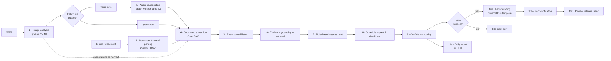

# Processing pipeline (GPU mode)

This document describes every step from a capture on the phone to a released letter or daily report, as it runs
in GPU mode (`SITEVOX_MODE=gpu`). For each step: method, model or library, output, and where the code lives.
Prompts are German in the code; § 11 shows them verbatim with English notes.



Orchestration: `sitevox/pipeline.py` (`ingest` → `_ingest_body` → `_photo_analyze` / `_extract_into` →
`_upsert_event` → `_score_event`).

---

## 1. Audio transcription

| | |
|---|---|
| **Input** | Voice note from the phone (browser WebM/Opus, or WAV), or a spoken answer to a photo question |
| **Model** | faster-whisper **large-v3** (CTranslate2, fp16) on the GPU, behind `scripts/cluster/asr_server.py` (`:8004`) |
| **Code** | `sitevox/understand/asr.py` (`backend = "remote"` on the laptop, `faster_whisper` on the GPU node) |

Steps:

1. **Decoding.** `imageio-ffmpeg` converts browser audio; faster-whisper's `decode_audio` loads 16 kHz mono.
2. **Language identification, restricted.** The language is detected per recording but only among
   `allowed_languages = [de, en, tr, pl]`, so accented German in noise is not misread as Dutch.
3. **Domain prompt per language.** `initial_prompt` with site vocabulary (Bewehrung, Schalung, Betonage,
   Kernbohrung DN150, Achse C …); the English, Polish and Turkish prompts keep the German technical terms, because
   crews often use them in any language. Plus `hotwords`.
4. **Decoding settings.** Beam size 5, Silero VAD filter, word timestamps.
5. **Word probabilities.** Every word keeps its probability (`score`); the mean over a quoted span becomes the
   ASR signal of the confidence score (§ 9).

**Output**

```json
{"text": "Bagger steht seit 09:30, der Maier ist mit dem Verbau nicht fertig …",
 "language": "de", "language_prob": 0.97, "backend": "remote:faster_whisper",
 "segments": [{"start": 0.0, "end": 4.2, "text": "Bagger steht seit 09:30 …",
               "words": [{"word": "Bagger", "start": 0.0, "end": 0.4, "score": 0.98}, …]}]}
```

---

## 2. Image analysis

| | |
|---|---|
| **Input** | Site photo (JPEG / PNG / HEIC) from the mobile capture page; the activities planned for today |
| **Model** | **Qwen3-VL-4B-Instruct** on vLLM (`:8003`), temperature 0.1, guided JSON decoding |
| **Libraries** | Pillow (EXIF, orientation, resize, crop) |
| **Code** | `sitevox/understand/vision.py`, `sitevox/pipeline.py:_photo_analyze` |

Steps:

1. **Metadata (deterministic).** Pillow reads EXIF `DateTimeOriginal` (converted to ISO with time zone) and the GPS
   IFD. The capture time is checked for plausibility against the upload time; otherwise the upload time is used.
2. **Pre-processing.** Rotate by EXIF orientation, downscale to a maximum side of 1536 px, re-encode as JPEG
   (quality 90) **without any metadata**. Less data through the tunnel, no GPS or device ID sent to the model.
3. **Visual understanding.** The VLM returns a `PhotoAnalysis` under a JSON schema (vLLM guided decoding),
   validated with Pydantic; on a schema violation up to 2 retries with the validation error as feedback.
4. **Role separation.** The VLM states only **what is visible**. No cause, no responsible party, no quantities
   or dimensions (photos are not to scale).
5. **Localisation.** Bounding boxes come from the VLM's native grounding (relative 0–1000). Each box is cropped
   with 4 % padding into its own image. There is no pixel-level segmentation; crops serve as visual evidence for
   human review, not as input to measurements.
6. **Evidence.** The original photo and every crop are stored as **evidence** (`source = photo`). The model's
   observations are stored as **hints** (`source = ai_vision`, `status = ai`). A hint becomes evidence only when the
   answer supports it (`corroborated`) or the site manager confirms it (`confirmed`).
7. **One follow-up question.** Chosen deterministically from the most important observation
   (obstruction / defect > safety > progress, then severity) from a fixed question table (§ 11.4). It asks exactly
   what the rules need and the photo cannot show.
8. **Answer.** By voice (→ step 1) or typed note. The answer, the question and the observations go to the
   extraction step together.

**Output**

```json
{"summary": "Randschalung der Bodenplatte an Achse D, ein Schalbrett sichtbar aus der Flucht, Zollstock quer aufgelegt.",
 "scene": {"bauteil": "Bodenplatte", "stage": "Randschalung gestellt", "activity_guess": "Schalung"},
 "observations": [{"category": "defect", "subtype": "surface_defect",
                   "description": "Ein Schalbrett der Randschalung steht sichtbar aus der Flucht.",
                   "bbox": [412, 318, 688, 540], "severity": "medium", "visual_conf": 0.74}],
 "followup_question": "Ist das unsere Leistung oder eine Vorleistung? Bitte Detailfoto mit Maßstab."}
```

Categories and subtypes: `obstruction` (blocked_access, standing_water, material_storage, equipment_idle),
`defect` (crack, surface_defect, damage), `progress` (stage_change), `safety` (safety_hazard). At most 6
observations per photo.

---

## 3. Document and e-mail parsing

| Input | Method | Code |
|---|---|---|
| PDF, DOCX, scans, images | **Docling** (layout analysis, tables, OCR) → Markdown + tables per page | `understand/documents.py` |
| PDF without Docling | pdfplumber (word coordinates → table columns), pypdf; RapidOCR for pages without a text layer | `understand/pdf_layout.py`, `ocr.py` |
| GAEB (X81–X86, GAEB 2000/90) | `gaeb` library → LV items with quantity and unit | `understand/gaeb_io.py` |
| `.eml` | Python `email` (policy `default`): sender, recipients, subject, date, plain-text body | `understand/email_ingest.py` |
| Mailbox | IMAP read-only, deduplicated by Message-ID, assigned to a project by contract number, project name and known senders | `understand/imap_mail.py` |
| Bauzeitenplan | openpyxl → activities, durations, FS/SS links, milestones | `engine/schedule.py` |
| Contract | Rules: contract number, dates, parties, authorised representative, deadlines, "nicht bevollmächtigt" | `understand/contract_info.py` |
| Meeting minutes | Qwen3-8B → `MinutesSummary` (3–6 bullet points, open items with owner and date) | `understand/extract.py:summarize_minutes` |

Documents are chunked (900 characters, 150 overlap) and indexed for retrieval (§ 6). E-mail bodies go to
extraction (§ 4) like a typed note.

---

## 4. Structured information extraction

| | |
|---|---|
| **Input** | Transcript, typed note or e-mail body; for photo answers also the question, the observations and the scene |
| **Model** | **Qwen3-4B-Instruct-2507** on vLLM (`:8001`), guided JSON decoding (`response_format = json_schema`, strict) |
| **Code** | `sitevox/understand/extract.py`, prompts in `sitevox/prompts.py`, schema `sitevox/schemas.py:Extraction` |

Steps:

1. **Prompt assembly.** System prompt (§ 11.1) + user prompt with project, capture date and time, source, known
   activities, known equipment (with aliases), known crews, and the input text (§ 11.2). For photo answers the
   photo context block is appended (§ 11.3).
2. **Main run** at temperature 0.0, `max_tokens` 4096. Every field of the schema is required, so the model must
   decide on every category (empty list = nothing found).
3. **Validation and retry.** Pydantic validation; on failure up to 3 retries with the error as feedback; from the
   second attempt the temperature is raised to ≥ 0.3 so a broken output is not repeated.
4. **Consistency sampling.** 5 further samples at temperature 0.7. Agreement per field across samples becomes the
   consistency signal of the confidence score (§ 9).
5. **Fallback.** If no valid JSON is returned, a keyword heuristic produces a minimal extraction instead of
   aborting.
6. **Post-processing in code.** Equipment names are mapped to project devices via aliases
   (excavator / koparka / ekskavatör → Bagger); the staffing total is computed as `regular_staff + additional_staff`
   (never by the model); activities are matched to the schedule.

**Output schema (`Extraction`)**

| Field | Content |
|---|---|
| `summary` | 1–2 sentences on the whole input |
| `events[]` | Disruptions: one of 10 types, description, cause, start/end time, affected activities, resource effects, `responsible_party_guess` + rationale, flags (`predecessor_by_owner`, `own_work`, `work_started`, `owner_supplied_material`, `ordered_by`), `blocked_until`, verbatim `quotes` |
| `progress[]` | Activity, quantity, unit, quote |
| `staffing[]` / `staffing_total` | Headcount per named crew / total without crew (`regular_staff`, `additional_staff`) |
| `log_entries[]` | Routine diary entries: `delivery`, `equipment_use` (state in_operation / idle / restricted / under_inspection / not_used), `inspection`, `visit`, `work_done` |
| `open_items[]` | Topic, responsible person, due date, quote |

Event types: `material_delay`, `equipment_failure`, `weather_interruption`, `worker_shortage`,
`third_party_interference`, `design_error`, `quality_defect`, `additional_work`, `planlieferverzug`,
`leistungsaenderung`.

**Example output** for *"Bagger steht seit 09:30, der Maier ist mit dem Verbau nicht fertig. Heute 150 Kubik
Aushub."*

```json
{"summary": "Bagger steht seit 09:30, weil der Verbau von Maier nicht fertig ist; 150 m³ Aushub.",
 "events": [{"type": "third_party_interference",
             "description": "Bagger steht still, weil der Verbau des Vorunternehmers Maier nicht fertig ist.",
             "cause": "Verbau Vorunternehmer nicht fertig", "start_time": "09:30",
             "affected_activities": ["Aushub BA1"], "responsible_party_guess": "AG",
             "responsible_rationale": "Vorunternehmer im Auftrag des Bauherrn", "predecessor_by_owner": true,
             "quotes": ["Bagger steht seit 09:30, der Maier ist mit dem Verbau nicht fertig"]}],
 "progress": [{"activity": "Aushub BA1", "quantity": 150, "unit": "m³", "quote": "Heute 150 Kubik Aushub"}],
 "staffing": [], "staffing_total": null,
 "log_entries": [{"kind": "equipment_use", "resource": "Bagger", "state": "idle", "time": "09:30",
                  "text": "Bagger im Stillstand.", "quote": "Bagger steht seit 09:30"}],
 "open_items": []}
```

---

## 5. Event consolidation

| | |
|---|---|
| **Method** | Deterministic matching |
| **Code** | `pipeline.py:_find_mergeable`, `_upsert_event` |

A new event is merged into an existing event of the same day when type, affected activities and resources match;
evidence is appended instead of creating a duplicate. A new cause always creates a new event. Events of earlier
days can be continued or closed by later captures. For each field (start, affected activities, blocked until,
sphere guess) the agreement across the 5 samples is stored as `field_stats`.

**Output:** `Event` record with ID `EVT-<date>-<n>`, linked evidence IDs, field statistics.

---

## 6. Evidence grounding and retrieval

| | |
|---|---|
| **Method** | Hybrid retrieval: BM25 + BGE-M3 dense vectors (Chroma), fused with `hybrid_alpha = 0.6`, reranked with bge-reranker-v2-m3 |
| **Collections** | `project_docs` (contract, LV, plan delivery list, minutes; filtered by project), `legal_vob` (VOB/B, BGB) |
| **Code** | `sitevox/rag.py`, `pipeline.py:_upsert_event` |

1. The event description is searched in the project documents (top 8 → rerank → top 4). Hits become contract
   evidence with a quote (best sentence) and a retrieval score.
2. For additional work, `rag.lv_contains` checks whether the LV already contains the item; `not_in_lv = true`
   is a rule input.
3. For letters, the legal basis is retrieved from `legal_vob` as a reference for the reviewer.

**Output:** contract / LV evidence on the event, retrieval score per hit.

---

## 7. Rule-based assessment

| | |
|---|---|
| **Method** | Rule matrix per event type, based on § 6 Abs. 2 VOB/B; no LLM decision |
| **Code** | `sitevox/engine/sphere.py`, `sitevox/engine/weather.py` |

| Event type | Default sphere | Reason |
|---|---|---|
| `material_delay` | AN | procurement risk of the contractor; AG if owner-supplied |
| `equipment_failure` | AN | own equipment |
| `weather_interruption` | AN | normal weather must be expected; neutral if DWD data exceed the thresholds |
| `worker_shortage` | AN | own staff |
| `third_party_interference` | AN | AG only if the third party is a preceding contractor of the client |
| `design_error` | AG | the client owes the design |
| `quality_defect` | AN | AG if the defect is in preceding work of another contractor |
| `additional_work` | AG | work requested by the client, not agreed |
| `planlieferverzug` | AG | supplying drawings is the client's duty |
| `leistungsaenderung` | AG | order by the client |

1. Flags from extraction (`predecessor_by_owner`, `owner_supplied_material`, `own_work`) and the DWD weather
   assessment (Bright Sky, thresholds in `rules.toml`) adjust the default.
2. `recommend()` maps sphere and type to the document: Behinderungsanzeige (§ 6 Abs. 1), Mehrkostenankündigung
   (§ 2 Abs. 6), Nachtragsankündigung (§ 2 Abs. 5), Bedenkenanzeige (§ 4 Abs. 3), or diary only.
3. The LLM's `responsible_party_guess` is only compared with the rule result: disagreement produces a warning
   and lowers confidence, but never changes the decision.
4. Additional checks, e.g. "work already started – the notice must be sent before execution".

**Output:** `sphere`, `sphere_rule` (reason), `recommended_document`, `warnings`.

---

## 8. Schedule impact and deadlines

| | |
|---|---|
| **Method** | Critical path method on the imported schedule; forecast at the current rate |
| **Code** | `sitevox/engine/schedule.py`, `deviation.py`, `deadlines.py` |

1. Planned vs. actual per activity and day; alert when daily output < 85 % of target.
2. Forecast finish = remaining quantity ÷ average actual daily output of the last 3 working days + blocked days;
   propagated through FS/SS links to successors and milestones.
3. Alert when a critical-path activity is delayed ≥ 1 working day or a contract milestone is exceeded.
4. Deadlines per document: Behinderungsanzeige "without delay"; Mehrkostenankündigung **before execution**
   (critical if already started); Nachtrag "as early as possible".

**Output:** delay days, impact chain (e.g. *Bewehrung BP +2 AT → Betonage BP → Wände EG 18.12. instead of 16.12.*),
milestone overrun, deadline status.

---

## 9. Confidence scoring

| | |
|---|---|
| **Method** | Weighted combination of signals, renormalised over the available signals; **no LLM self-assessment** |
| **Code** | `sitevox/confidence.py`, weights in `config/rules.toml [confidence]` |

| Signal | Weight | Source |
|---|---|---|
| evidence | 0.35 | field points to ≥ 1 raw evidence item (none → 0, red) |
| consistency | 0.30 | agreement across the 5 extraction samples |
| asr | 0.15 | mean word probability of the quoted audio span |
| retrieval | 0.10 | rerank score of the cited contract / LV passage |
| rule | 0.10 | deterministic plausibility rule (violation → penalty 0.35) |

Bands: green ≥ 0.80, yellow 0.50–0.80, red < 0.50 (manual confirmation required).
Review queue priority = (1 − confidence) × field importance.

---

## 10. Outputs

### 10a. Letter drafting

| | |
|---|---|
| **Model** | **Qwen3-8B** on vLLM (`:8002`), temperature 0.3, thinking off, guided JSON (`DraftBody`) |
| **Template** | Jinja2, `sitevox/drafting/templates/<kind>[.en].j2` |
| **Code** | `sitevox/drafting/composer.py:create_letter` |

1. **Engine facts.** `engine_facts()` writes the schedule calculation as sentences (daily output vs. target,
   planned vs. forecast finish, delay days, critical path, successors, milestone overrun, blocked until,
   LV comparison). These sentences are stored as their own evidence (`source = engine`).
2. **Evidence numbering.** Core evidence (voice, mail, note, original photo) → contract master data → engine
   facts → derived evidence (crops, AI observations) → `E-01, E-02 …`. Unconfirmed AI observations are labelled
   *"KEIN Beleg – nicht als Tatsache darstellen"*.
3. **Generation.** The 8B model writes only two paragraphs, **Sachverhalt** (facts) and **Auswirkungen** (impact),
   max. 5 sentences each, each sentence with evidence IDs, no legal citations (§ 11.6).
4. **Template.** Subject, reference, salutation, introduction, demand, reservation of rights and closing come
   from the template; **legal citations appear only there**.
5. **Fields.** Recipient and contract number (master data), event start, cause, sphere, affected activities
   (extraction + rules), impact in working days (engine), legal basis (template + retrieval), delivery method
   (company default, confidence 0.6) – each with confidence and evidence.

**Output (`DraftBody`)**

```json
{"sachverhalt": [{"text": "Am 23.11.2026 steht unser Bagger seit 09:30 Uhr still, da der Verbau an Achse 4 noch nicht fertiggestellt ist.",
                  "evidence": ["E-01", "E-03"]}],
 "auswirkungen": [{"text": "Der Aushub BA1 verzögert sich nach aktuellem Stand um 1 Arbeitstag.",
                   "evidence": ["E-06"]}]}
```

### 10b. Fact verification

`sitevox/verify.py`, deterministic string checks per sentence:

- every number, date, time and company / person name must occur in the cited evidence → otherwise **red**,
  export blocked until manually confirmed;
- every sentence needs ≥ 1 valid evidence ID;
- legal citations (§, VOB, BGB) in LLM text are forbidden;
- a sentence supported only by AI photo observations → **yellow** (`needs_confirmation`).

### 10c. Review, release and sending

The site manager confirms or edits each field, resolves red items and completes the checklist; only then can
the letter be released. Release opens the send dialog; sending via SMTP from the connected mailbox requires
`confirm: true`. Alternatives: `.eml` draft for Outlook, PDF (ReportLab) / DOCX (python-docx). Photos are attached
with faces blurred (OpenCV Haar cascade, pixelation) and without EXIF; time and GPS go into the caption. Every
step is written to the audit log.

### 10d. Daily report (Bautagesbericht)

`sitevox/export/daily_report.py:build` – **no LLM**. Pure data assembly from captures, events, engine results,
weather and master data, structured after VHB Bund guideline 411. Missing values stay empty instead of being
estimated.

| Section | Source |
|---|---|
| Weather | DWD via Bright Sky |
| Workforce | extracted staffing (editable) |
| Equipment | log entries and resource effects |
| Deliveries | log entries, matched to announcements |
| Site log | inspections, visits, other findings |
| Work performed, deviations, milestones at risk, impact chains | engine |
| Incidents | events with sphere, letter status, confidence |
| Photos | photos with time, GPS, caption, AI observations marked "not verified" |
| Sources | every row links to `VOICE-01`, `MAIL-01`, `PHOTO-01`, `PLAN` … and to evidence IDs |

The same structure is rendered as dashboard, JSON, PDF and DOCX.

---

## 11. Prompt examples

All prompts are in `sitevox/prompts.py`. `<<OUT>>` is replaced by the output language (German or formal British
English). Excerpts are verbatim; `[…]` marks omitted lines.

### 11.1 Extraction – system prompt (Qwen3-4B)

```text
Du bist ein Assistent für die Bauleitung eines Auftragnehmers (AN) auf einer deutschen Baustelle.
Aufgabe: Extrahiere aus Sprachnotizen, Notizen, E-Mails und Protokollen strukturierte Fakten.

GRUNDSATZ – ALLE KATEGORIEN PRÜFEN
Gehe jede Eingabe in dieser Reihenfolge durch und fülle JEDE zutreffende Kategorie:
  1. events  2. progress  3. staffing / staffing_total  4. log_entries  5. open_items
[…]
1. EVENTS – Störungen, Behinderungen, Abweichungen und vertragsrelevante Vorgänge
   Schlüsselwörter: steht (still), wartet, fehlt, nicht gekommen/geliefert, verspätet, […]
   en: idle, waiting, missing, late, not arrived, broken, defect, not in the bill of quantities, wants us to
   pl: stoi, czeka, brak, nie przyszło, spóźnione, zepsuty, wada, nie ma w przedmiarze, chce, żebyśmy
   tr: duruyor, bekliyor, eksik, gelmedi, gecikti, bozuk, kusur, metrajda yok, istiyor
   Beispiele:
   - "Bagger steht seit 09:30, Maier ist mit dem Verbau nicht fertig" → third_party_interference (AG)
     + log_entries equipment_use Bagger state "idle"
   - "Reststahl 1,5 t ist nicht gekommen, sollte um 10 da sein" → material_delay
   […]
   equipment_failure NUR bei technischem Defekt des Geräts. Steht ein Gerät, weil ein anderer (Vorunternehmer,
   Lieferant, Planer) nicht fertig ist, ist es der Typ dieser Ursache (z. B. third_party_interference).
   KEIN Ereignis: Routine ohne Abweichung ("Bagger läuft, Schlauch dicht", "leichter Regen, Folie liegt bereit").
[…]
3. STAFFING
   - Keine Kolonne genannt → "staffing_total" (crew NICHT raten):
     "alle 16 da und 2 Mann von der Baustelle Pasing" → regular_staff 16, additional_staff 2
     (NICHT selbst addieren – die Summe rechnet das System.)
[…]
ALLGEMEIN
- Nur extrahieren, was ausdrücklich in der Eingabe steht. Nichts erfinden, nichts berechnen.
- Die Eingabe kann Deutsch, Englisch, Türkisch oder Polnisch sein (auch gemischt). Zitate bleiben wörtlich in der
  Originalsprache; alle anderen Textfelder schreibst du auf <<OUT>>.
- Keine Rechtsbewertung, keine Paragraphen.
Antworte ausschließlich mit JSON nach dem vorgegebenen Schema.
```

Prompt engineering in this prompt: fixed category order (a diary entry never replaces an event), keyword lists and
examples in all four input languages, explicit negative examples (routine is not an event), type disambiguation
rules (idle equipment caused by others is not `equipment_failure`), "do not calculate" (sums are computed in code),
verbatim quotes in the original language as evidence anchors.

### 11.2 Extraction – user prompt

```text
Projekt: {project}
Erfassungsdatum: {date}, Uhrzeit: {time}, Quelle: {source}
Bekannte Vorgänge im Bauzeitenplan: {activities}
Bekannte Geräte: {equipment}
Bekannte Kolonnen: {crews}

Eingabe:
"""
{text}
"""{context}
```

### 11.3 Extraction – context for photo answers

```text
Kontext: Die Eingabe ist die Antwort des Poliers auf die Rückfrage zu einem Foto.
Gestellte Frage: "{question}"
KI-Beobachtungen aus dem Foto (automatisch erkannt, KEIN Beleg):
{observations}
Szene laut Foto: {scene}

Regeln für Foto-Antworten:
- Die KI-Beobachtungen sagen nur, WAS zu sehen ist. Ursache, Verursacher, Beginn, betroffene Vorgänge,
  Mengen und ob es eigene Leistung oder Vorleistung ist, NUR aus der Antwort übernehmen.
- "quotes" ausschließlich wörtlich aus der Antwort, nie aus den KI-Beobachtungen.
- Mengen (progress) nur, wenn sie in der Antwort genannt werden – nie aus dem Foto schätzen.
```

### 11.4 Image analysis – prompt (Qwen3-VL-4B)

```text
Du analysierst ein Baustellenfoto für die Bauleitung des Auftragnehmers. Beschreibe NUR, was sichtbar ist.

Liefere JSON:
- "summary": 2–3 sachliche Sätze auf {out_lang} für das Bautagebuch (Bauzustand, Geräte in Betrieb/abgestellt,
  Personen arbeitend/wartend – ohne Personen zu identifizieren).
- "scene": {"bauteil", "stage", "activity_guess"} – sichtbares Bauteil, Bauzustand, vermutlich laufende Arbeit.
- "observations": 0–6 Auffälligkeiten, je {"category", "subtype", "description", "bbox", "severity", "visual_conf"}
    category obstruction: blocked_access, standing_water, material_storage, equipment_idle
    category defect:      crack, surface_defect, damage
    category progress:    stage_change
    category safety:      safety_hazard
  "bbox" = [x1, y1, x2, y2] in relativen Koordinaten 0–1000 um die Auffälligkeit (oder null)
[…]
Strikte Regeln:
- Keine Vermutungen über Ursache, Verursacher, Verantwortliche oder Schuld.
- Keine Mengen, Maße oder Abmessungen schätzen (Fotos sind dafür nicht maßstäblich).
- Nichts erfinden, was nicht sichtbar ist. Lieber weniger Beobachtungen mit ehrlicher visual_conf.

Projektkontext (nur zur Einordnung, nicht als Beobachtung übernehmen):
Heute geplante Vorgänge: {activities}
```

Follow-up questions are **not** generated by the model; they come from a fixed table per subtype, e.g.:

| Subtype | Question (English UI) |
|---|---|
| `blocked_access` | Who is blocking the access (company/trade, on behalf of the client?), since when, and which works are affected? |
| `equipment_idle` | Whose equipment is this, why is it idle, and since when? |
| `crack` | Is this our own work or work by a preceding contractor? Please take a close-up photo with a scale. |
| `stage_change` | What quantity was completed today (e.g. t, m², m³), and for which activity? |

### 11.5 Meeting minutes (Qwen3-8B)

```text
Fasse ein Baubesprechungsprotokoll für die Bauleitung des AN zusammen.
- "summary": 3–6 Stichpunkte, sachlich.
- "open_items": offene Punkte mit Verantwortlichem und Termin (ISO-Datum), jeweils mit wörtlichem Zitat.
Nur Inhalte aus dem Protokoll, nichts ergänzen. Antworte als JSON.
```

### 11.6 Letter drafting – system and user prompt (Qwen3-8B)

```text
Du formulierst für die Bauleitung des Auftragnehmers zwei Absätze eines förmlichen Schreibens an den
Auftraggeber: "sachverhalt" und "auswirkungen". Betreff, Bezug, Rechtsgrundlagen, Vorbehalt und Grußformel
stehen bereits in der Vorlage – schreibe sie NICHT.

Strikte Regeln:
1. Jeder Satz endet mit den Beleg-IDs, auf die er sich stützt, im Feld "evidence" (z. B. ["E-01","E-03"]).
2. Verwende ausschließlich Zahlen, Daten, Uhrzeiten und Namen, die in den Belegen oder in den
   berechneten Fakten wörtlich vorkommen. Keine eigenen Berechnungen, keine Schätzungen.
3. Keine Paragraphen, keine Normen, keine Rechtsbegriffe wie "Anspruch" oder "Schadensersatz".
4. Sachlich, knapp, Sie-Form gegenüber dem AG, aus Sicht des AN ("wir").
5. Maximal 5 Sätze je Absatz.
6. Sprache der Sätze: <<OUT>>. Wörtliche Zitate aus Belegen bleiben in ihrer Originalsprache (in Anführungszeichen).
Antworte ausschließlich mit JSON nach Schema.
```

```text
Art des Schreibens: {kind_label}
Ereignis: {event_label} – {description}

Berechnete Fakten (aus Terminplan-Engine, zitierfähig als {engine_id}):
{facts}

Belege:
{evidence}
```

Example of the filled user prompt:

```text
Art des Schreibens: Behinderungsanzeige
Ereignis: Planlieferverzug – Bewehrungspläne Achse C Index b fehlen

Berechnete Fakten (aus Terminplan-Engine, zitierfähig als E-07):
Terminplan-Berechnung (Stand 20.11.2026, Prognose bei aktuellem Tempo):
Bewehrung BP: geplantes Ende 23.11.2026, prognostiziertes Ende 25.11.2026, Verzug 2 Arbeitstage (kritischer Pfad).
Wände EG fertig am 16.12.2026: Prognose 18.12.2026, Überschreitung um 2 Arbeitstage.

Belege:
[E-01] Sprachnotiz 07:30 (audio, 20.11.2026 07:30): „Bewehrungspläne Achse C Index b fehlen …“
[E-02] Mail Tragwerksplaner (email, 20.11.2026 12:15): „voraussichtlich Montag …“
[E-03] Foto Achse C (photo, 20.11.2026 07:31) [Fotodatei – Anlage]: …
[E-08] KI-Beobachtung · equipment_idle (ai_vision) [KI-Beobachtung, KEIN Beleg – nicht als Tatsache darstellen]: …
```

### 11.7 Letter template (Jinja2, excerpt of `behinderungsanzeige.j2`)

```text
### betreff
Behinderungsanzeige gemäß § 6 Abs. 1 VOB/B – {{ event_label }} ({{ f.affected_activities | join(', ') }})
### bezug
Bauvorhaben {{ project.title }}, Bauvertrag Nr. {{ f.contract_no }} vom {{ contract_date }}; {{ project.contract_basis }}
### einleitung
hiermit zeigen wir Ihnen gemäß § 6 Abs. 1 VOB/B an, dass wir in der ordnungsgemäßen Ausführung unserer
vertraglichen Leistungen behindert sind. Die Behinderung besteht seit {{ start_de }}.
### sachverhalt
[[SACHVERHALT]]          ← Qwen3-8B
### auswirkungen
[[AUSWIRKUNGEN]]         ← Qwen3-8B
### vorbehalt
Wir behalten uns vor, die Verlängerung der Ausführungsfristen gemäß § 6 Abs. 2 und Abs. 4 VOB/B sowie
Ansprüche nach § 6 Abs. 6 VOB/B und § 642 BGB geltend zu machen. […]
```

---

## 12. Model and serving summary

| Role | Model | Port | Precision | Context | Temperature | GPU memory share |
|---|---|---|---|---|---|---|
| Extraction | Qwen3-4B-Instruct-2507 | 8001 | bf16 | 16k | 0.0 (+5 samples at 0.7) | 0.18 |
| Drafting, minutes | Qwen3-8B | 8002 | bf16 | 32k | 0.3 | 0.30 |
| Vision | Qwen3-VL-4B-Instruct | 8003 | bf16 | 16k | 0.1 | 0.20 |
| ASR | faster-whisper large-v3 | 8004 | fp16 | – | beam 5 | remainder |

All on one GPU, started one after another by `scripts/cluster/serve_models_single.sbatch`. Structured
outputs use vLLM guided decoding (`response_format = json_schema`, strict), validated with Pydantic.
